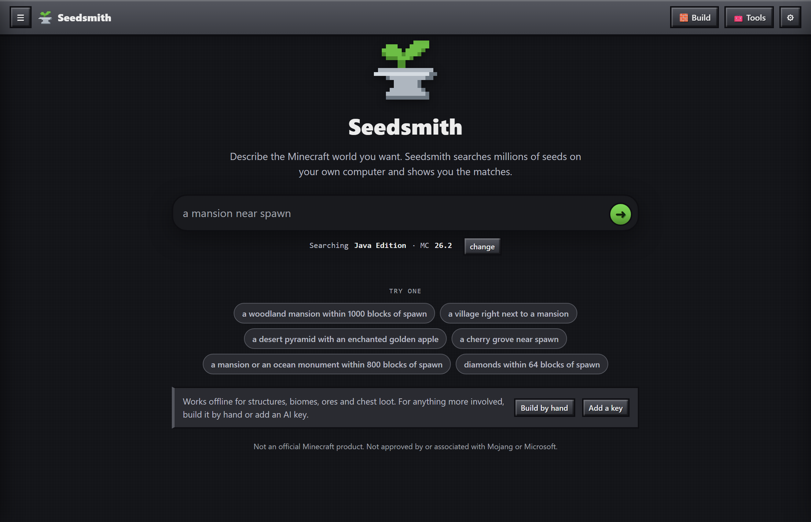
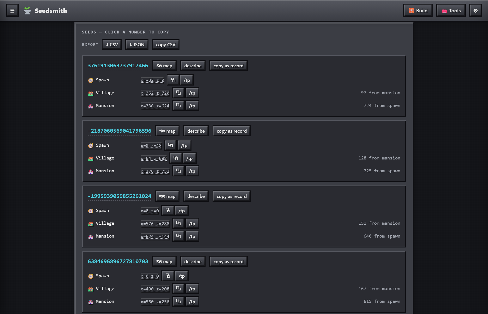
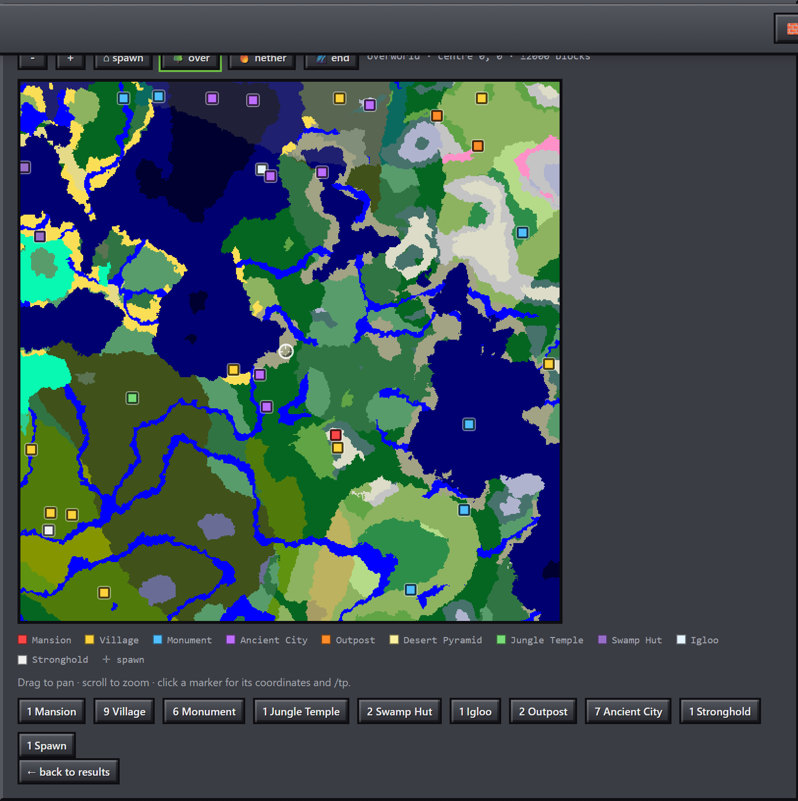

<p align="center">
  
</p>

<h1 align="center">Seedsmith</h1>

<p align="center">
  Describe the Minecraft world you want, and get seeds and coordinates.<br>
  Runs on your own computer. Free and open source.
</p>

<p align="center">
  <a href="https://github.com/Woblu/Seedsmith/releases/latest"><b>Download</b></a> ·
  <a href="docs/reference.md">Manual</a> ·
  <a href="docs/accuracy.md">How accurate is it?</a> ·
  <a href="https://github.com/Woblu/Seedsmith/issues">Report a problem</a>
</p>

<p align="center">
  
</p>

## Get started

1. [Download the latest release](https://github.com/Woblu/Seedsmith/releases/latest) for your computer:

   | Your computer | Download |
   |---|---|
   | Windows, 64-bit | `seedsmith-…-windows-x86_64.zip` |
   | Mac with Apple silicon (M1 or later) | `seedsmith-…-macos-arm64.zip` |
   | Linux, x86-64 | `seedsmith-…-linux-x86_64.tar.gz` |
   | Linux, ARM64 | `seedsmith-…-linux-arm64.tar.gz` |

2. Unzip it anywhere. There is nothing to install.
3. Start it:
   - **Windows:** double-click `Seedsmith.bat`. If SmartScreen appears, choose **More info**, then **Run anyway**.
   - **Mac:** Control-click `Seedsmith.command` and choose **Open**.
   - **Linux:** run `./start.sh`.

A browser tab opens. Type what you want and press Enter:

> a woodland mansion within 1000 blocks of spawn

> a desert pyramid with an enchanted golden apple

> a mansion or an ocean monument within 800 blocks of spawn

## What you can search for

| | |
|---|---|
| **Structures** | Villages, mansions, monuments, temples, strongholds, ancient cities, trial chambers, fortresses, bastions, end cities and more, including variants like zombie villages or end ships |
| **Biomes** | Any biome, near a place or next to another biome, or how much of an area it covers |
| **Loot** | What is in the chests of pyramids, jungle temples, igloos, outposts, shipwrecks, fortresses, bastions and ruined portals |
| **Ores** | How much ore is nearby, the size of a vein, and whether you can see it from a cave |
| **The rest** | End portal eyes, slime chunks, survival islands, tall mountains, structures that overlap |
| **Logic** | Combine anything with AND, OR and NOT |

The prompt box reads common requests by itself, with no account and no internet. For
anything it cannot follow, it tells you what it missed instead of guessing. You can
then build the search by hand, or add a free AI key for more involved requests.

<p align="center">
  
</p>

Every result gives you coordinates, a ready-to-paste `/tp` command, and a biome map of
the overworld, nether and end, with the structures marked. You can export results to
CSV or JSON, share a search as a link, and check a list of seeds you already have.

<p align="center">
  
</p>

## Questions

**Which versions does it support?** Java Edition 1.12 through 26.2. Choose the version
under the prompt box, and make sure it matches the version you play: the same seed
makes a different world on a different version.

**Does it work for Bedrock?** No. Bedrock places structures differently, so a Java seed
will not have the same structures there.

**Why does Windows or my Mac warn me?** The downloads are not code-signed, which costs
money every year. You can compare your download with `SHA256SUMS.txt` on the release
page, or build it yourself.

**Does it send anything anywhere?** No. There is no telemetry and no update check.
The one exception is an AI key, if you add one: what you type in the prompt box then
goes to the provider you chose. See [SECURITY.md](SECURITY.md).

**Will it slow my computer down?** It uses all but one of your processor's cores while
searching, and you can stop any search and keep what it found.

**Where is the structure it told me about?** Almost always one of these: the version
doesn't match, a ruined portal is buried, or the spot was measured from a spawn point
that is only an estimate. [Accuracy](docs/accuracy.md) explains each one.

**How do I use a seed?** Copy it from a result and paste it into the **Seed** box when
creating a new world.

## How accurate is it?

Seedsmith generates worlds with [cubiomes](https://github.com/xpple/cubiomes), a
reimplementation of Minecraft's generator, so results are computed rather than looked
up in a list.

- **Structure positions** match an independent reference: 3,881 of 3,881 checked.
- **Chest loot** was checked against a real 1.21.1 server, chest by chest: 10 of 10.
- **Every platform generates the same worlds.** Windows, Linux and macOS, on Intel and
  ARM, are compared byte for byte on every change.

Some results are estimates, and Seedsmith labels them. World spawn is the main one. The
[accuracy page](docs/accuracy.md) lists what has been checked, how, and what has not.

## Build from source

You need `clang`, `git`, `bash` and Python 3. On Windows, use Git Bash.

```sh
git clone https://github.com/Woblu/Seedsmith.git
cd Seedsmith
./setup.sh           # fetch the pinned engine
./build.sh all       # build everything
python serve.py      # opens http://127.0.0.1:8777
```

From the command line, `./build/find.exe queries/mansion-village.json` runs a search
written as JSON. The [manual](docs/reference.md) covers the query format, every
condition and how the planner works. A few specialist tools run the real Minecraft
generator instead: see [advanced tools](docs/advanced-tools.md).

Contributions are welcome. See [CONTRIBUTING.md](CONTRIBUTING.md).

## Credits

Seedsmith is built on [cubiomes](https://github.com/Cubitect/cubiomes) by Cubitect, in
[the fork by xpple](https://github.com/xpple/cubiomes) that keeps it current, with the
loot library by ScriptLine and cJSON by Dave Gamble. All are MIT licensed. See
[THIRD_PARTY_NOTICES.md](THIRD_PARTY_NOTICES.md).

## License and contact

MIT, see [LICENSE](LICENSE). Published by Woblu. For questions and bug reports, use
[GitHub issues](https://github.com/Woblu/Seedsmith/issues). For security problems, see
[SECURITY.md](SECURITY.md).

**NOT AN OFFICIAL MINECRAFT PRODUCT. NOT APPROVED BY OR ASSOCIATED WITH MOJANG OR
MICROSOFT.** Minecraft is a trademark of Mojang.
